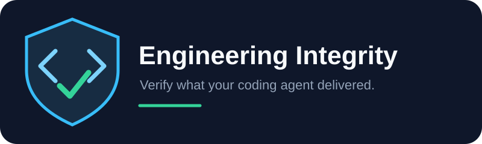

# Engineering Integrity



**Verify what your coding agent delivered.**

Engineering Integrity is one portable coding-agent skill that reviews completed code against the original requirements. It checks scope, architecture, test quality, regression risks, bug fixes, and completion evidence. When authorized, it coordinates corrections through your existing workflow and verifies the result within a bounded loop.

After using Superpowers, Ponytail, REA, or any other coding skill, cross-check the result with Engineering Integrity. It adds a verification layer to the workflow you already use.

Engineering Integrity reviews the delivered code, challenges unsupported completion claims, and returns evidence-backed findings. It is not a guarantee that software has no defects.

## Install

The installer requires Node.js 20 or newer. The skill itself is Markdown and needs no Node.js at runtime.

### From GitHub

Run this from your target project:

```sh
npx --yes --package=github:modalqa/engineering-integrity engineering-integrity install --agent all
```

### From npm

After the package is published to npm and the name is available:

```sh
npx engineering-integrity install --agent all
```

The package name is engineering-integrity. npm install installs a dependency; npx runs this package's installer. This source checkout does not mean the package has already been published.

### From a local checkout

```sh
node bin/cli.mjs install --agent all --cwd /path/to/your-project
```

Choose --agent codex, claude, copilot, or cursor for one host; repeat --agent for several. Use --dry-run to preview paths or --cwd PATH to choose a project. The default is all four hosts in the current directory.

| Host | Project-local destination |
| --- | --- |
| Codex | .agents/skills/engineering-integrity |
| Claude Code | .claude/skills/engineering-integrity |
| GitHub Copilot | .github/skills/engineering-integrity |
| Cursor | .cursor/skills/engineering-integrity |

Installation copies the entire skill folder. There are no vendor dependencies, install hooks, telemetry, global mode, or model calls. Identical installations are left unchanged. Different existing files cause an error instead of being overwritten. To upgrade, preserve or move your existing skill folder first. To uninstall, remove only its engineering-integrity folder from the chosen host directory.

Reload the agent session if discovery is cached. Host versions and interfaces vary; see [framework adaptation](skills/engineering-integrity/references/framework-adaptation.md) for official sources. Kilo and other Agent Skills hosts can use a manual folder copy to their documented skill directory.

## Use

After your agent finishes implementation, ask:

> Use engineering-integrity in audit mode. Compare the implementation with the original task and acceptance criteria. Inspect actual changes and report findings with current evidence. Do not modify implementation files.

For authorized corrections:

> Use engineering-integrity in full mode for this task. Keep the existing implementation workflow. Allow at most 3 correction rounds and 2 failed attempts per finding. Verify each correction and report anything unresolved.

In Codex, refer to $engineering-integrity. Claude Code also supports /engineering-integrity. In Copilot and Cursor, ask the agent to use the skill by name.

Provide the original task, acceptance criteria, and an appropriate Git baseline when available. Missing context becomes a verification limitation, not an invented requirement. Non-Git snapshots are supported where practical.

## Use with your existing coding skills

Use your preferred skills to plan and implement. Then ask Engineering Integrity to check the result:

> I have finished implementation using Superpowers, Ponytail, REA, or my other coding skills. Now use engineering-integrity to cross-check the delivered result against the original task, acceptance criteria, actual changes, and current evidence. Challenge unsupported completion claims. Report actionable findings. In full mode, return authorized corrections to the same implementation workflow and verify each correction before accepting it.

You do not need to install or use all of these skills. They are examples, not dependencies or bundled integrations. The [handoff contract](skills/engineering-integrity/references/ecosystem-handoff.md) works through the current agent's capabilities and does not assume vendor-specific hooks.

## Check a structured report

Full and correction mode produce a JSON report using the portable [schema](skills/engineering-integrity/templates/report.schema.json). Choose an output path in your request, or use the default .engineering-integrity/reports/ location. Chat-only output and repository restrictions take precedence. Audit mode writes a report file only when requested.

Check the report locally:

```sh
node bin/cli.mjs check-report report.json
```

After npm publication:

```sh
npx engineering-integrity check-report report.json
```

The checker rejects false VERIFIED claims when mandatory requirements are incomplete, evidence is missing or from an old snapshot, a blocking finding remains open, required checks are unavailable, or a claimed fix has no verification evidence. It also checks iteration limits and failed-attempt counters.

Exit 0 means the report is internally consistent; an honest BLOCKED or UNVERIFIED report can pass this check. Exit 1 means invalid JSON, invalid structure, or inconsistent claims. The checker never executes commands contained in a report. It cannot prove that evidence is authentic or relevant. See [structured-report guidance](skills/engineering-integrity/references/structured-report.md).

## Test the verification layer

Thirteen executable fixture projects cover the twelve PRD scenarios plus an acceptable-trade-off control. They include deliberately broken implementations, weak assertions, unavailable verification, corrected stages, and recurring defects after renames.

```sh
node bin/cli.mjs prepare-evaluation weak-assertions ./review-fixture
# Ask your agent to review review-fixture using engineering-integrity.
# Save its JSON report outside that fixture, then score it:
node bin/cli.mjs score-evaluation weak-assertions ./report.json
```

Preparation withholds the evaluator oracle. Scoring reports true positives, false positives, missed defects, precision, recall, status agreement, and false acceptance. Read [evaluation instructions](tests/scenarios/README.md) before interpreting scores. Fixture execution and ledger tests do not establish cross-agent review accuracy.

Local correction tests execute the failing code, apply a prepared correction in an isolated copy, and rerun assertions. They also verify that an unrelated regression remains open, old findings can reopen, completion claims cannot close findings, and recurring defects stop at the configured limit.

Negative controls deliberately break behavior in an isolated copy to check that important assertions detect it. The strong assertion rejects the mutation; the weak assertion fixture accepts incorrect behavior. Use the [risk-based procedure](skills/engineering-integrity/references/negative-controls.md) rather than mutating the working application.

## Modes and results

- **audit:** inspect and report without editing implementation files.
- **correction:** audit, coordinate authorized corrections, and verify them.
- **full:** default; discover, audit, correct, re-audit, verify, and report.

Supply limits in your request: max_iterations defaults to 3; max_repeated_attempts defaults to 2. The initial audit is round 0. Zero correction rounds are allowed.

| Result | Meaning |
| --- | --- |
| VERIFIED | Every mandatory gate passes with current evidence and no unresolved warnings |
| VERIFIED WITH WARNINGS | Mandatory gates pass; nonblocking concerns or justified trade-offs remain |
| BLOCKED | A confirmed blocking defect or unauthorized scope change remains |
| UNVERIFIED | Missing context or evidence prevents mandatory verification |

Passing tests alone do not prove requirements were met. Independent reviewers are used only when available and permitted; otherwise the report discloses the separate-pass limitation. Reports include requirement traceability, findings, evidence, iteration history, and remaining risks.

## Project layout

The [skill entry point](skills/engineering-integrity/SKILL.md) routes to four workflows, seven internal auditors, four policies, report templates, a JSON schema, and focused references. Auditors are responsibilities, not seven separately installed skills.

## Development and release

Run validation locally. GitHub Actions is not configured or required.

```sh
npm test
npm run validate
npm pack --dry-run
```

Installer, report, fixture, and correction-loop tests run locally in isolated temporary projects. [Behavioral scenarios](tests/scenarios/README.md) explain how to evaluate a real reviewing agent. See [validation](docs/validation.md) for completed checks and limitations.

Repository: [modalqa/engineering-integrity](https://github.com/modalqa/engineering-integrity).

Before publishing, run the checks above, confirm npm name ownership, inspect the tarball, and publish from an authenticated maintainer account with npm publish --access public. Installation and testing never publish anything.

## License

MIT. See [LICENSE](LICENSE).
